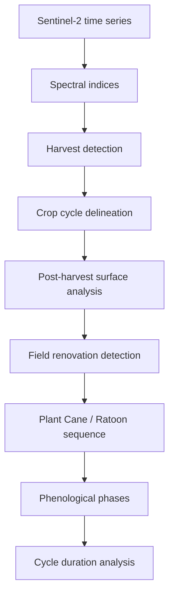
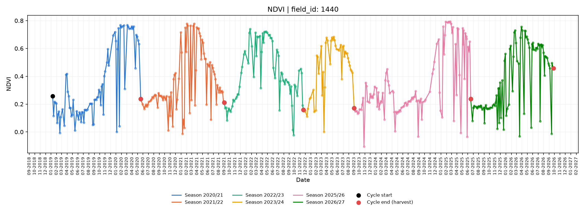
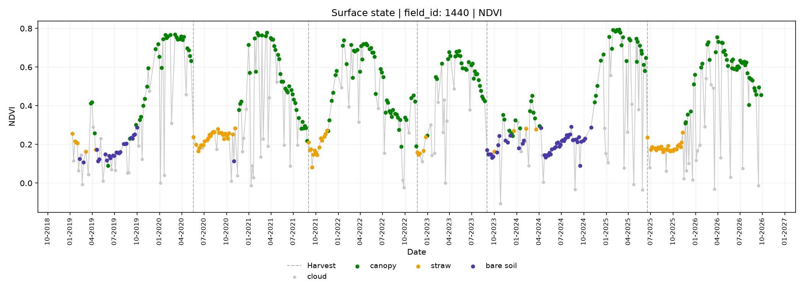
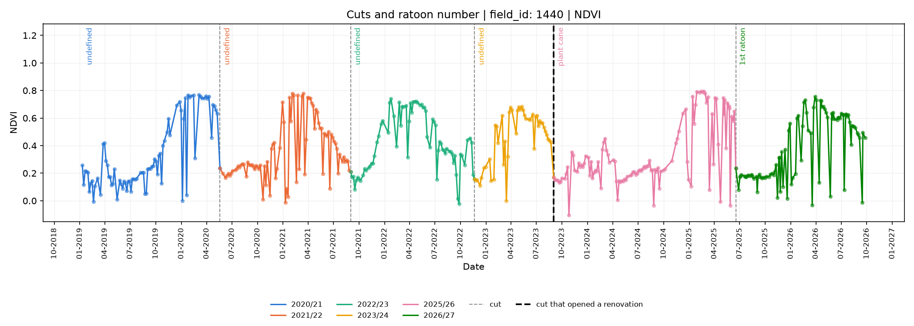
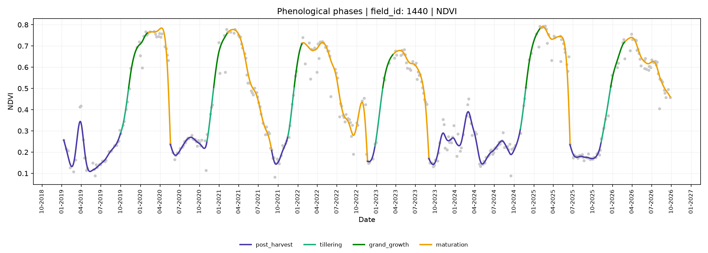

# Sugarcane Crop Cycle Analysis Using Sentinel-2

A remote sensing pipeline for reconstructing sugarcane production history
from Sentinel-2 time series.

The project detects harvest events, delineates individual crop cycles,
identifies potential field renovation, reconstructs Plant Cane and ratoon
sequences, and characterizes phenological development using spectral
indices.

Sugarcane is a semi-perennial crop, understanding when harvests and renovations occurred and which cycle a field is currently in is essential for interpreting temporal behavior and supporting agronomic monitoring. Since this production history is not publicly available, the pipeline reconstructs it directly from spectral observations.

Worked example: two fields, 964 observations, January 2019 to September 2026.
The figures below are from field 1440; the notebook runs both.

## Pipeline overview



## 1. Harvest Detection and Crop Cycle Delineation

Harvest causes a sharp decline in NDVI and exposes straw or bare soil, increasing SWIR reflectance relative to NIR. An observation is therefore flagged as a harvest candidate when B11 > B8A and NDVI <= 0.30. A new harvest can only be detected after the canopy has recovered above NDVI 0.50, preventing the same event from being counted repeatedly while the field remains bare or covered by crop residue.

Detected harvest dates are then visually validated using satellite imagery to confirm the transition from standing sugarcane to a harvested field.

Crop cycles run from one detected harvest to the next; the first and last are flagged as
open. Crop years follow the Centre-South season, April to March.



## 2. Field Renovation and Crop Stage Identification

Sugarcane is first harvested as Plant Cane and then as successive ratoons until field renovation resets the sequence. Identifying renovation events is therefore essential for assigning the correct stage to each crop cycle.

### 2.1 Residue cover

NDTI is converted into estimated residue cover (0-100%) following the Embrapa ZARC methodology (DOC-454, 2023), with values scaled between the mean plus or minus three standard deviations. The stretch is fitted only over dates with no canopy, since standing cane carries the highest NDTI of all and would otherwise set the fully-covered anchor. This represents a spectral estimate of residue cover rather than a direct field measurement. Cover is estimated per observation, and summarized per crop cycle in 2.3, where it decides renovation.

### 2.2 Surface classification

Every observation is labelled, so the post-harvest surface is read directly
instead of inferred from NDVI. Cloud is tested first, so an obscured surface is
never taken for canopy or straw.

| Class | Rule |
|---|---|
| `cloud` | High B1 reflectance **and** NDMI; overrides every other class |
| `canopy` | NIR > SWIR, or NDVI above the harvest threshold |
| `straw` | No canopy and residue cover >= 45% |
| `bare soil` | No canopy and residue cover < 45% |



September 2023 stands out as an exception in this field: the post-harvest surface remains predominantly bare soil (purple) for nearly a year, whereas all other harvests are followed by straw cover (orange).

### 2.3 Renovation detection and ratoon sequence

A cycle is flagged as **potential renovation** when the median cover over its
bare stretch falls below 45%, consistent with straw removed or incorporated
during soil preparation. That cycle is the Plant Cane, the next is the First
Ratoon, and so on. Cycles before the first renovation stay undefined.

The window is the cycle's own bare period rather than a fixed span after the
cut, because tillage keeps the ground open for months and because the first
cycle of a record opens on the limit of the series, with no cut to anchor a
window to. A cycle holding fewer than five bare observations is left undecided
instead of guessed: that is what separates a first cycle the record caught
while the ground was still bare, which reads like any other, from one it
caught with the canopy already closed.



## 3. Phenological Phase Detection

Phenological phase boundaries are derived from the shape of each crop-cycle
curve. To reduce noise, each cycle is first smoothed on a daily grid using a
Whittaker filter (Eilers, 2003), while observations identified as cloudy are
excluded from influencing the fitted curve.

Each cycle is divided into two broad phases at the peak of the smoothed EVI
curve. Before the peak, the canopy is still developing and vegetation activity
is increasing; after the peak, canopy development stabilizes or declines as
the crop enters its post-peak development and maturation period.

The phase boundary is defined using **EVI** because it remains more sensitive
than NDVI under dense canopy conditions. NDVI tends to saturate near maximum
canopy development, producing a broad plateau in which the exact peak may be
difficult to locate. The EVI peak therefore provides the transition date,
which is then projected onto the **NDVI time series** used to represent the
overall crop-cycle trajectory. 

In the figure below the EVI curve is drawn thin
behind the coloured one, with that peak marked, so the boundary can be checked
against the curve it was read from.

| Phase | Starting landmark | Agronomic meaning |
|---|---|---|
| `post_harvest` | Harvest | Early regrowth, below visible canopy |
| `growth` | Last bare date before the peak | Canopy establishment and stalk elongation |
| `maturation` | EVI peak | Growth slows, sucrose accumulates |

A cycle whose landmarks cannot be read, having no bare observation before the
peak or landmarks out of chronological order, is left `unclassified` rather
than forced into phases. One of the 14 cycles falls there.



## Key Results

| | Field 1440 | Field 1460 |
|---|---|---|
| Harvests detected | 5 | 7 |
| Crop cycles | 6 | 8 |
| Renovations flagged | 2 | 1 |
| Cycles with a named stage | 6 of 6 | 1 of 8 |
| Median cycle length | 468 days | 340 days |
| Median maturation | 184 days | 191 days |

- **12 harvests and 14 cycles** reconstructed from 964 observations, with no
  cloud mask and no field records.
- **Three renovations flagged**, at 27.8%, 33.3% and 34.4% median cover over
  the bare stretch. Every ratoon cycle fell between 51.6% and 68.2%, the range
  expected of a green-cane harvest that leaves straw on the ground, so the 45%
  threshold sits in a 17-point gap rather than between neighbours.
- Field 1440 comes out with a **complete stand history**: Plant Cane, first,
  second and third ratoon, then a renovation and a new Plant Cane and first
  ratoon. Its earliest renovation is one the cut itself is missing from - the
  record opens with the straw already ploughed under - so it is read from the
  ground rather than from the harvest that caused it.
- Field 1460 stays mostly unnamed on purpose: the record caught it with the
  canopy closed, so its first cycle holds a single bare observation and is left
  undecided, which breaks the chain until the 2025 renovation.
- The Plant Cane cycle after renovation in field 1440 lasted **655 days**,
  consistent with an 18-month planting (*cana de ano e meio*). The renovation
  was dated without knowing the planting system, and the cycle length agrees.
- Phase durations, read against each field's own median, are the windows the
  planned climate analysis will be joined to. Field 1440 carries cycles about
  four months longer than 1460, while maturation takes a similar share of both.

## Methodology

Thresholds are module-level constants, overridable per call and collected in
the first cell of the notebook.

| Parameter | Default | Role |
|---|---|---|
| `HARVEST_NDVI_MAX` | 0.30 | NDVI at or below which no live canopy remains |
| `CANOPY_NDVI_MIN` | 0.50 | Recovery required before a new harvest is accepted |
| `SEASON_START_MONTH` | 4 | Crop year opens in April (Centre-South) |
| `STRAW_COVER_MIN` | 45% | Straw/bare soil split, and the renovation threshold |
| `CYCLE_MIN_BARE_IMAGES` | 5 | Bare observations a cycle needs to be decided |
| `WHITTAKER_LAMBDA` | 1000 | Smoothing roughness penalty |

Indices are computed once and reused: NDVI (harvest, cycle shape), EVI (end of
growth), NDRE (visualization), NDMI (cloud) and NDTI (residue cover).

## Data

The repository includes the data used to reproduce the analysis, organized into three levels:

### Raw data

`data/raw/` contains the original inputs used by the pipeline:

- `fields_example_s2.csv` — Sentinel-2 time series for the analyzed fields.
- `spectral_library.csv` — spectral reference samples used to support surface interpretation.

The Sentinel-2 table contains one row per field and acquisition date, including
the acquisition date, `field_id`, image metadata, pixel count, and Sentinel-2
L2A surface reflectance bands.

### Vector data

`data/vector/` contains the field geometries used in the analysis:

- `fields_example.geojson` — boundaries of the example sugarcane fields.

### Processed data

`data/processed/` contains tables generated by the analysis pipeline, including:

- spectral indices
- detected harvest dates
- crop-cycle boundaries
- surface-state classification
- residue-cover estimates
- renovation events
- ratoon sequence
- smoothed time series
- phenological landmarks
- phenological phase durations

All processed tables are regenerated from the raw inputs by running the notebook.


## Repository structure

```
cane_cycle/
├── src/cane_cycle/     # io, vegetation_indices, harvest, residue,
│                       # field_renovation, smoothing, phenology, plotting
├── notebooks/          # sugarcane_cycle_analysis.ipynb - the full pipeline
├── data/raw/           # input CSV (not versioned)
├── data/processed/     # derived tables (not versioned)
├── figures/            # saved plots
├── pyproject.toml
└── requirements.txt
```

## How to run

```bash
python -m venv .venv
.venv\Scripts\activate          # Windows
source .venv/bin/activate       # Linux / macOS

pip install -r requirements.txt
pip install -e .
```

Put the extract in `data/raw/` and run
`notebooks/sugarcane_cycle_analysis.ipynb`. Every table and figure is
regenerated from the thresholds in its first cell.

## Limitations

- **Remote-sensing-based inference:** harvest dates, renovation events, ratoon stages, and phenological phases are inferred from Sentinel-2 time series and satellite-image interpretation. Harvest dates were visually checked against the imagery, but no independent field or mill records were available for external validation.
- **Spectral confusion:** different surface conditions can produce similar spectral responses, which may introduce ambiguity in the classification. For example, heavy straw removal may resemble field renovation, while partial cloud contamination or mixed pixels may affect the observed signal.
- **Ratoon sequence depends on renovation detection:** the ratoon sequence can only be assigned once a renovation event is identified, because renovation resets the cycle back to Plant Cane. Since a sugarcane field may remain productive through more than six ratoon cycles before renovation, a sufficiently long satellite time series is required to capture at least one renovation event and reconstruct the sequence reliably.

## References

- Embrapa. *Niveis de Manejo do ZARC*, DOC-454, 2023.
  https://www.infoteca.cnptia.embrapa.br/infoteca/handle/doc/1156802
- Eilers, P. H. C. A perfect smoother. *Analytical Chemistry*, 75(14), 2003.
